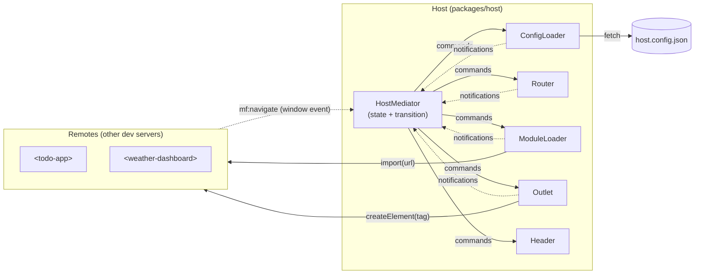
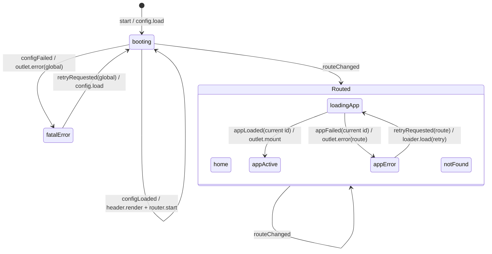
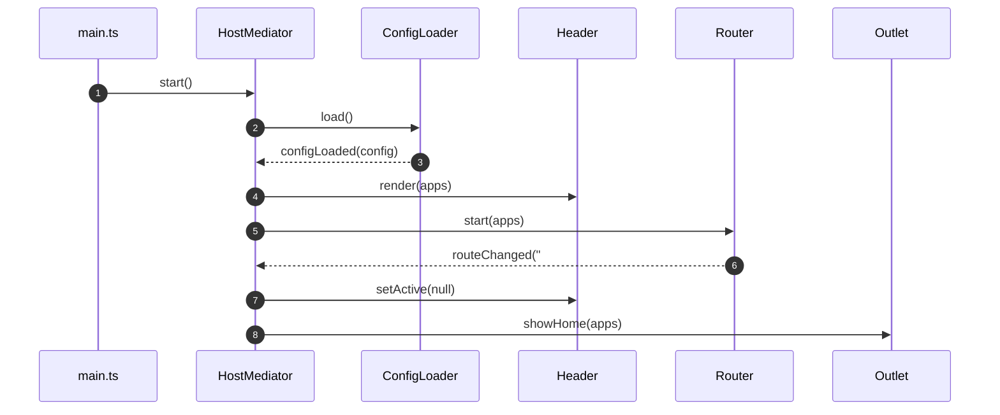
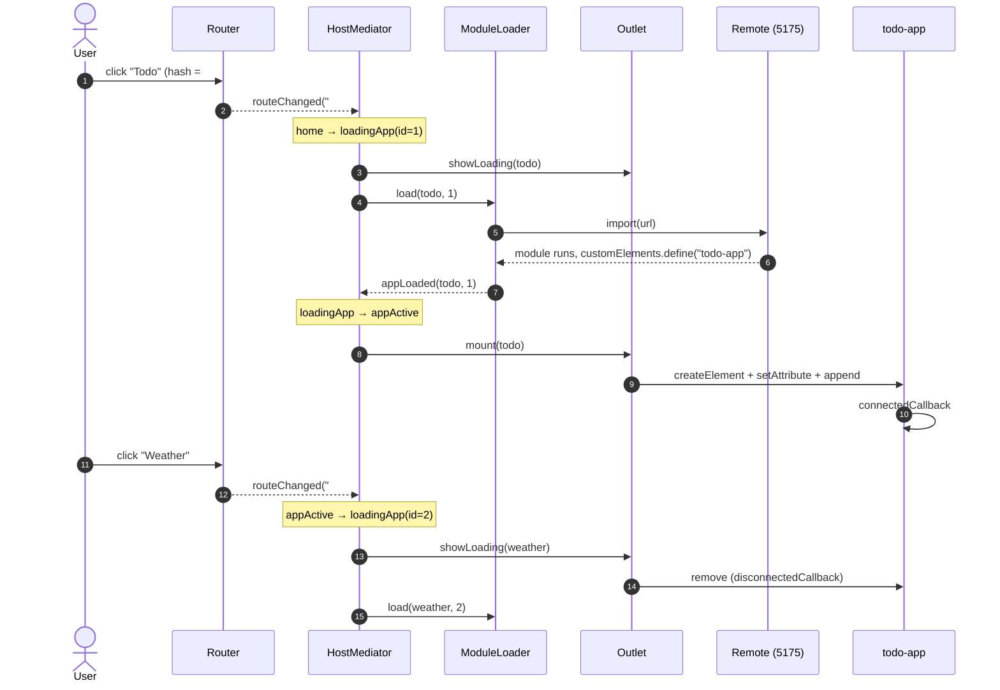
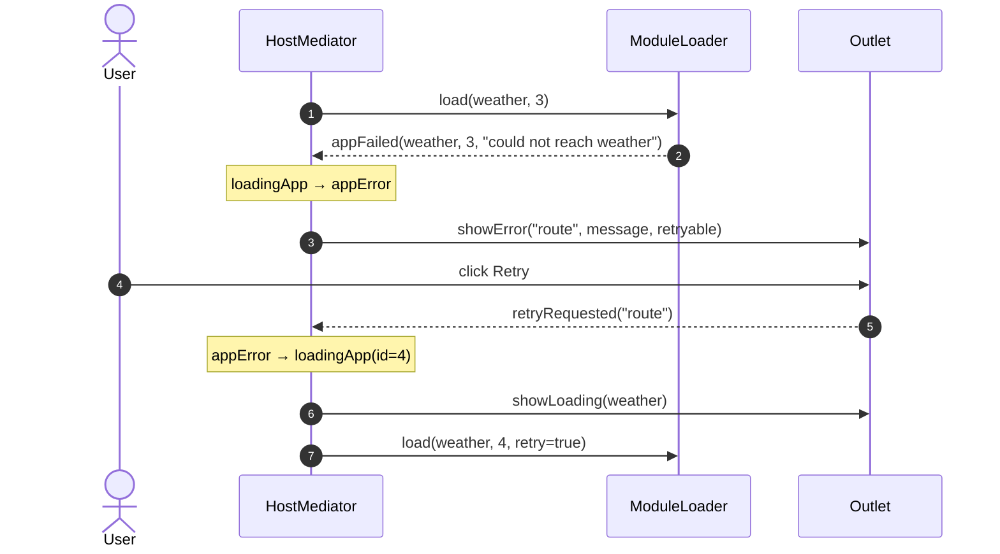
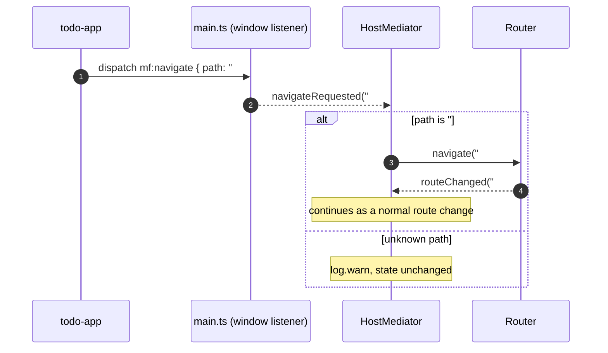

# M1: Host shell

Parent spec: [01.init-spec.md](../specs/01.init-spec.md). Milestone index: [README.md](README.md).

## 1. Goal

Build the host (shell) and prove that it can compose independently built micro-frontends at runtime, before any real app or auth exists.

At the end of M1, the host must:

1. **Boot from a manifest.** Fetch and validate `host.config.json`. The manifest is the only thing the host knows about each app (`route`, `url`, `tag`).
2. **Route by hash.** Map `#/<name>` to a manifest entry. `#/` is the host's home view; an unknown route shows a not-found view.
3. **Load an app on first visit only.** Later visits reuse the already registered element.
4. **Mount exactly one app at a time.** Create the custom element in the outlet, and remove the previous one on route change.
5. **Contain failures.** A remote that is down, slow, or broken affects only its own route: an error panel with Retry replaces it, and the header and other routes keep working.
6. **Accept navigation requests from apps.** An app asks to navigate with the `mf:navigate` event; the host decides whether to act on it.

Out of scope for M1: auth (M2), Vue and Lit apps (M3, M4), production layout and deployment (M5), theming (M6). The remotes in M1 are vanilla placeholder elements.

## 2. Architecture

### 2.1 Why a mediator

Booting, routing, loading, mounting and error handling all involve several components at the same time. If each component called the others directly (the router mounting elements, the loader drawing error panels), the order of steps would be spread across the code and every component would depend on every other one.

With the Mediator pattern, one object, the `HostMediator`, owns every cross-component decision. The other components are **colleagues** that each do one job and report what happened.

### 2.2 Participants

| Role | Component | Does | Never does |
|---|---|---|---|
| Mediator | `HostMediator` | Holds the host state, decides the next step, sends commands to colleagues | Touch the DOM, fetch, import |
| Colleague | `ConfigLoader` | Fetches and validates the manifest | Decide what happens after a failure |
| Colleague | `Router` | Listens to `hashchange`, resolves the hash to a manifest entry, sets `location.hash` on request | Load or mount anything |
| Colleague | `ModuleLoader` | `import(url)` + `whenDefined(tag)`, with timeouts and retry; skips the import if `customElements.get(tag)` is already defined | Touch the DOM |
| Colleague | `Outlet` | Owns `#mf-outlet`: shows home, loading, error, not-found, or mounts an element | Decide what to show |
| Colleague | `Header` | Renders nav links from the manifest, highlights the active one | Navigate on its own (links are plain `<a href="#/...">`) |
| External colleague | Remote element | Renders inside its Shadow DOM; may dispatch `mf:navigate` | Know about the mediator or other apps |

### 2.3 Communication rules

1. **Colleagues → mediator: notifications only.** Each colleague gets a `notify(event)` callback in its constructor and reports facts (`configLoaded`, `configFailed`, `routeChanged`, `appLoaded`, `appFailed`, `retryRequested`).
2. **Mediator → colleagues: commands only.** The mediator calls colleague methods (`load()`, `navigate()`, `mount()`, ...). Commands never return decisions to the mediator; results come back later as notifications.
3. **No colleague imports another colleague.** Dependencies point one way: `main.ts` wires colleagues to the mediator.
4. **Remotes talk to the host only through the contract** (`@mf/shared-contracts`): attributes in, `mf:navigate` out. One window listener in `main.ts` turns `mf:navigate` into a `navigateRequested` notification.
5. **The decision logic is a pure function.** `transition(state, event) → { state, commands }` has no DOM and no I/O, so every rule can be unit-tested. `HostMediator` only stores the state, calls `transition`, and runs the returned commands.

### 2.4 Behaviour: host state machine

The mediator's state is the single source of truth for what the user sees.

Key behaviours:

- **Routing is the same from every state.** Once the config is loaded, `routeChanged` selects the next state from the hash alone: `#/` → `home`, a declared route → `loadingApp`, anything else → `notFound`. This includes the first route, which the router reports as soon as it starts.
- **Activation id.** Each entry into `loadingApp` gets a new id. An `appLoaded` / `appFailed` whose id is not the current one is stale (the user already navigated away) and is ignored with a warning.
- **`fatalError` is only for a broken manifest.** A broken remote leads to `appError` (goal 5).
- **M2 extension point.** Auth adds states (`loadingAuth`, `unauthenticated`, `authError`) between `booting` and the route states. Colleagues and the transition shape stay the same.

### 2.5 Behaviour: collaboration sequences

#### Boot and first route

#### Open an app (first visit), then leave it

#### Remote fails, user retries

#### App asks the host to navigate

