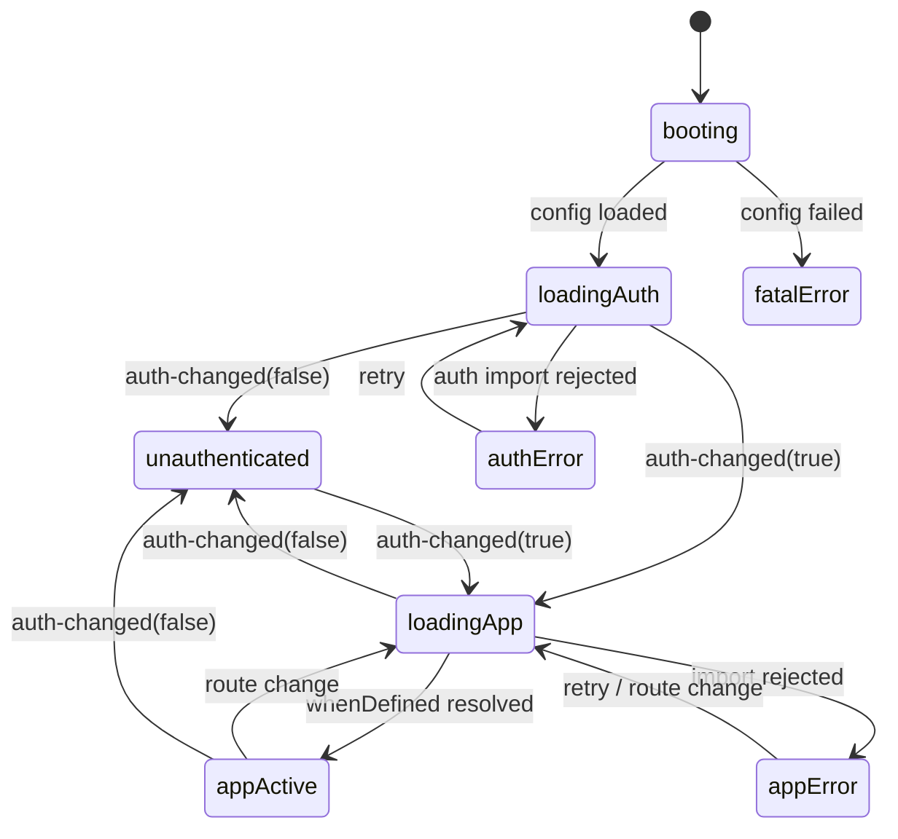

# Micro-frontend

Explorer project: compose independently built and deployed apps in one page, using [Web Components](https://developer.mozilla.org/en-US/docs/Web/API/Web_components) as the only integration contract.

## Goals
- Compose independently deployed apps at runtime through custom elements.
- Share one auth component (login/session) between apps without sharing a framework.

## Non-goals
- Production hardening (SSR, SEO, i18n, a11y audit).
- A real backend. Data is stored per user in `localStorage`.

# Architecture

Each micro-frontend is an ES module whose side effect is `customElements.define(tag)`. The host loads it with `import(url)`, mounts the tag, and knows nothing else about it. Apps render into their own Shadow DOM and talk only through `CustomEvent`s.

Browser support: Custom Elements v1 baseline (Chrome 67, Firefox 63, Safari 10.1, Edge 79). No IE. Autonomous custom elements only (Safari has no `is="..."`).

## Runtime flow

1. Host fetches `host.config.json` once.
2. Host imports the shared auth module (always first). It defines `mf-login` / `mf-user-menu`, restores the session, exposes `window.mfAuth`, and dispatches `mf:auth-changed`.
3. Unauthenticated: host mounts `<mf-login>` and waits for `mf:auth-changed` (`authenticated: true`).
4. Authenticated: host matches the hash route. If `customElements.get(tag)` is undefined it runs `import(url)`, then awaits `whenDefined(tag)`, creates the element and appends it to the content area.
5. On route change the host removes the element. The definition stays registered, so the next visit skips the import.
6. Failures:
   - App import rejects: error panel with retry for that route only; the header and other routes keep working.
   - Auth import rejects: global error panel with retry.
   - Logout while an app is active: host removes the app and mounts `<mf-login>`.

## Manifest (`host.config.json`)

```json
{
  "auth": { "url": "./remotes/auth/auth.js", "tags": ["mf-login", "mf-user-menu"] },
  "apps": {
    "todo":    { "route": "#/todo",    "url": "./remotes/todo/todo-app.js",       "tag": "todo-app" },
    "weather": { "route": "#/weather", "url": "./remotes/weather/weather-app.js", "tag": "weather-dashboard" }
  }
}
```

Relative URLs in production; `http://localhost:<port>/...` in dev.

## Integration contract (the only coupling)

| Channel | Contract |
|---|---|
| Elements | Tag name + attributes. The host only creates, configures and removes them. |
| Events (on `window`, `bubbles`, `composed`) | `mf:auth-changed` `{ authenticated, user }`, `mf:navigate` `{ path }` |
| UserContext `window.mfAuth` | `getUser()` → user or `null`; `getAccessToken()` → token or `null`. Read in `connectedCallback`, then follow `mf:auth-changed`. |
| Styling | CSS custom properties only (`--mf-color-primary`, `--mf-font-family`, ...). |

### Namespacing rules

Shadow DOM does not isolate the global custom element registry, events, storage or `window`. So:

- Each app defines only its **root element**; internal UI stays framework components inside the shadow root.
- Tag prefixes are owned: `todo-*`, `weather-*`, `mf-*` (auth).
- The host rejects duplicate tags across manifest entries at startup.
- Apps don't share element-defining libraries; every `define` is guarded with `customElements.get(tag)`.
- Events use `mf:`; storage keys use `<feature>:<user.sub>`; the only global is `window.mfAuth`; nothing is injected into `document.head`.

## Host internals: Mediator

`HostMediator` is a pure state machine `(state, event) → (state, commands)`. It holds no DOM, `fetch` or `import()` code. Colleagues do the work, get a `notify(event)` callback, and never call each other. Micro-frontends never see the mediator; they use only the contract.

| Colleague | Responsibility |
|---|---|
| `ConfigLoader` | Fetch and validate `host.config.json` (incl. duplicate tags). |
| `Router` | `hashchange` → `routeChanged(entry)`. Mounts nothing. |
| `ModuleLoader` | `import(url)` + `whenDefined(tag)`, cached. Touches no DOM. |
| `Outlet` | `showLoading`, `mount(tag, attrs)`, `showLogin`, `showError(scope, retry)`, `clear`. |
| `Header` | Nav links from config, `<mf-user-menu>` slot, active route. |



Rules:
- `routeChanged` while unauthenticated is ignored (login stays).
- `mf:navigate` is validated against known routes, then sets `location.hash`.
- Each activation gets an increasing `activationId`; `appLoaded` / `appFailed` with a stale id are ignored (fast navigation, logout during load).
- Only the mediator listens to contract events for host decisions. Apps may still subscribe to `mf:auth-changed` for their own rendering.

# Authentication

OIDC Authorization Code + PKCE via `oidc-client-ts`, against an **Auth0** free-tier SPA client (public, no secret).

- Config in `auth.config.json`: `authority`, `client_id`, `redirect_uri` (host base URL), `post_logout_redirect_uri`, `scope: "openid profile email offline_access"`. These are public values, safe to commit.
- Auth0: callback, logout and web-origin URLs set to the Pages URL and `http://localhost:5173`; refresh token rotation on.
- Project-specific behavior:
  - Before `signinRedirect()`, save the current hash route.
  - The IdP redirects to the base URL with `?code&state` (hash routing, no `/callback`). On startup the auth module handles the callback before the host matches a route, then clears the query and restores the saved route.
  - Session lives in `sessionStorage`.
  - Silent renew failure and logout both emit `mf:auth-changed` (`authenticated: false`).

# Feature specs

## Todo app (`<todo-app>`, Vue 3)
- Add (title required, max 200 chars), toggle, inline edit, delete.
- Filter all / active / done; remaining counter; "clear completed".
- Stored in `todos:<user.sub>`; reloads on `mf:auth-changed`. No attributes or events in v1.
- Acceptance: todos survive reload; another user sees a different list; logout hides the list.

## Weather dashboard (`<weather-dashboard>`, Lit)
- Search cities via [Open-Meteo Geocoding](https://open-meteo.com/en/docs/geocoding-api); save up to 10 in `cities:<user.sub>` as `{ id, name, country, lat, lon }`; remove a city.
- One card per city from [Open-Meteo Forecast](https://open-meteo.com/en/docs) (`current=temperature_2m`, `daily=weather_code,temperature_2m_max,temperature_2m_min,precipitation_probability_max`, `timezone=auto`, `forecast_days=1`): current temp, min/max, precipitation chance, WMO code label/icon.
- Refresh on load, every 15 min (timer cleared on disconnect), and manually. Loading/error state per card.
- `units="metric|imperial"`, default metric.
- Acceptance: new card within 2s; duplicate lat/lon rejected; offline shows last data marked stale.

## Shared auth (`<mf-login>`, `<mf-user-menu>`, `window.mfAuth`)
- `<mf-login>`: "Sign in" button; shows callback errors.
- `<mf-user-menu>`: avatar, name, "Sign out"; hidden when unauthenticated.
- No app-specific logic.

## Host
- Header (title, Todo / Weather links, `<mf-user-menu>`) + content area.
- Hash routes from the manifest: `#/`, `#/todo`, `#/weather`.
- Loading placeholder while an app loads; error panel with retry on failure.

# Repository layout

```
packages/
  host/  auth/  todo-app/  weather-app/
  shared-contracts/   # event names, detail types, UserContext type
package.json          # npm workspaces
```

Dev: one Vite server per package (host 5173, auth 5174, todo 5175, weather 5176), CORS on; `npm run dev` starts all.

# Deployment (GitHub Pages)

One Pages artifact, one subpath per package (same origin, no CORS):

```
/<repo>/                   host
/<repo>/host.config.json   manifest
/<repo>/remotes/auth/      auth bundle
/<repo>/remotes/todo/      todo bundle
/<repo>/remotes/weather/   weather bundle
```

CI on push to `main`: `npm ci`, build each package (Vite `base` per subpath), assemble `dist/`, deploy with `actions/upload-pages-artifact` + `actions/deploy-pages`.

# Milestones
Details: [docs/milestones](../milestones/README.md).

1. Host, manifest, hash routing, two placeholder elements from separate dev servers; loading and error panels.
2. Shared auth: Auth0 login/logout, `window.mfAuth`, `mf:auth-changed`, auth-first startup, route guard.
3. Todo app with per-user persistence.
4. Weather dashboard.
5. GitHub Pages deploy with Auth0 URLs set.
6. Polish: theming, error states, README.

# Decisions
- Auth0 free tier (SPA, Code + PKCE).
- Vue 3 (todo) + Lit (weather) to prove the contract is framework-agnostic.
- GitHub Pages, hash routing, single artifact.
- Auth always loads before any app.
- Host coordinated by a `HostMediator` state machine.
