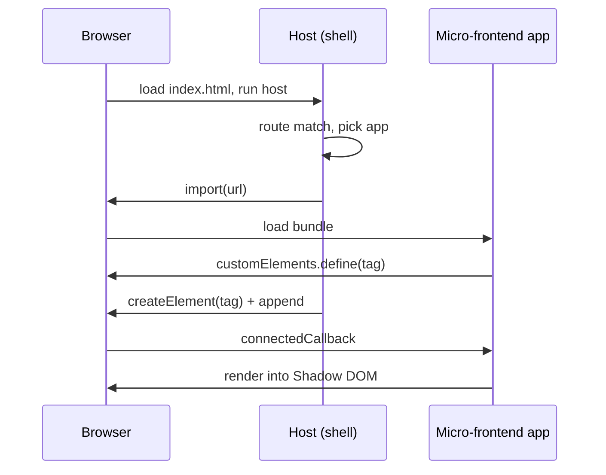
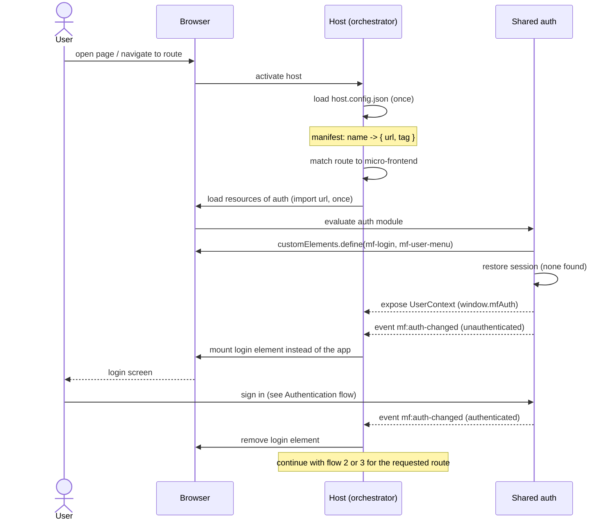
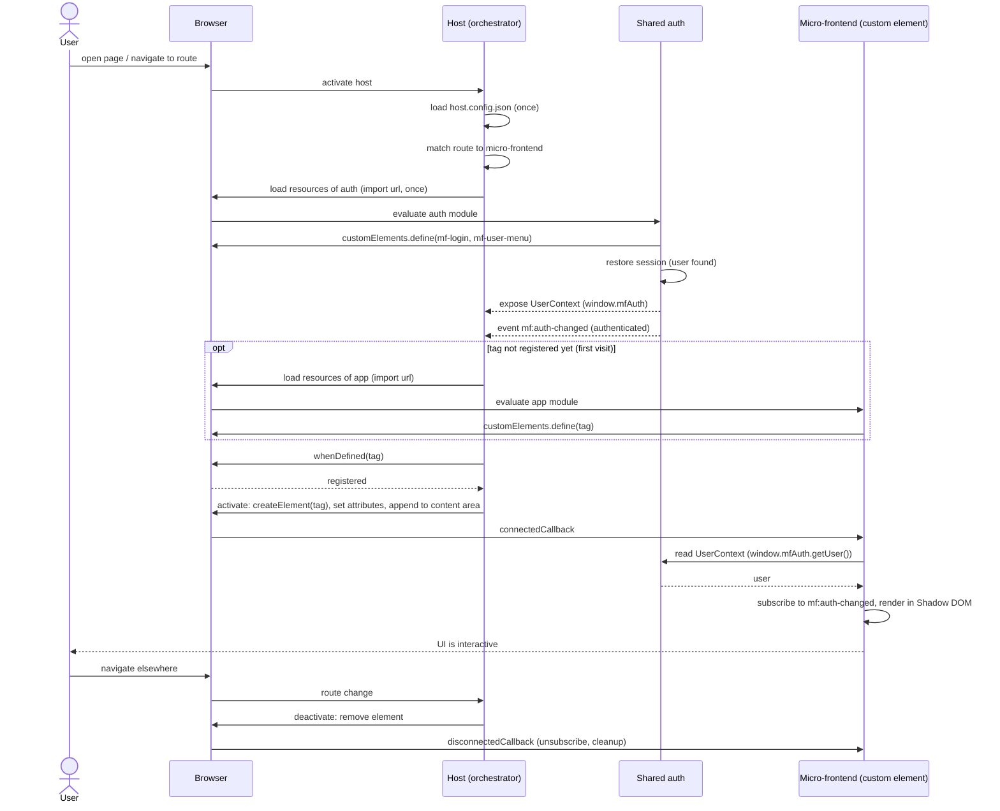
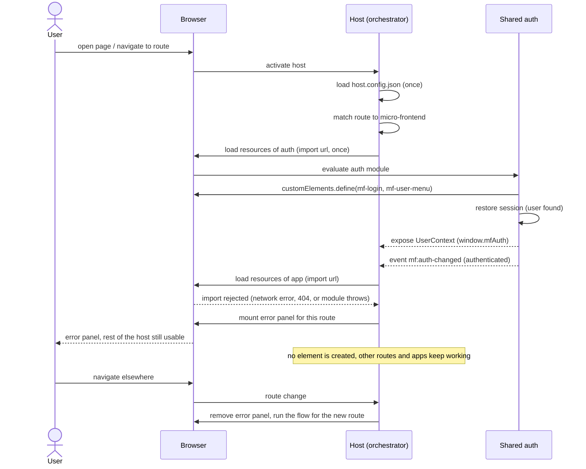
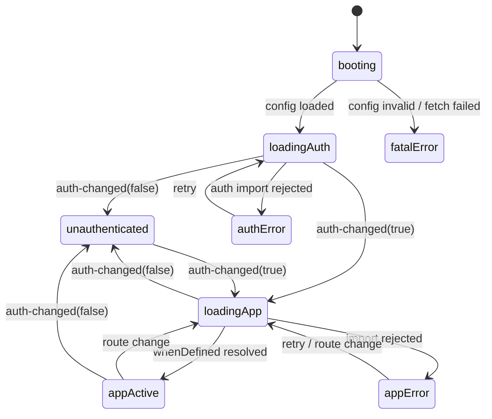
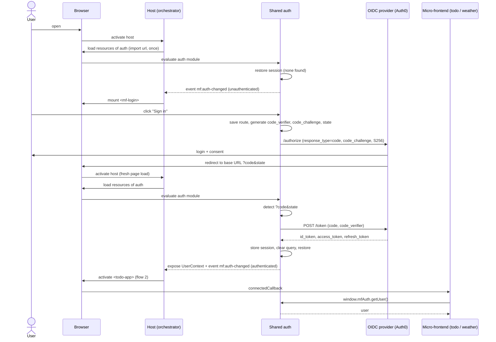

# Micro-frontend
This is an explorer project for micro-frontend with web components (https://developer.mozilla.org/en-US/docs/Web/API/Web_components) approach.

## Goals
- Show that independently built and deployed apps can be composed in one page using **Web Components** as the integration contract.
- Share one authentication component (login/session) between apps without sharing a framework.   

## Non-goals
- Production hardening (SSR, SEO, i18n, a11y audit).
- A real backend. Data is stored client-side (localStorage) per user.

# Architecture

## Core idea

A micro-frontend is an independently built and deployed UI that the host page composes at runtime. Here, **the browser's Web Components standard is the integration layer**: each micro-frontend registers a custom element, and the host only uses that element's tag name, attributes and events. Nothing else (framework, state, build tool) is shared.

| Web Components feature | Role in the architecture |
|---|---|
| Custom Elements | The deployable unit and public interface of a micro-frontend (`<tag attr>`) |
| Shadow DOM | Style and DOM isolation between micro-frontends and the host |
| DOM events (`CustomEvent`) | Cross-micro-frontend communication, no shared store |
| ES modules + dynamic `import()` | Runtime loading of each micro-frontend bundle |

### Supported browsers

The architecture needs Custom Elements (`customElements.define`), Shadow DOM, ES modules and dynamic `import()`. Custom Elements is the newest of these, so it sets the minimum version. It is Baseline "Widely available" (all major browsers since January 2020). Reference: [MDN CustomElementRegistry](https://developer.mozilla.org/en-US/docs/Web/API/CustomElementRegistry).

| Browser | Minimum version |
|---|---|
| Chrome / Chrome for Android | 67 |
| Edge | 79 |
| Firefox / Firefox for Android | 63 |
| Safari / Safari on iOS | 10.1 / 10.3 |
| Opera | 54 |

- Internet Explorer is not supported.
- Customized built-in elements (`is="..."`) are not supported in Safari, so micro-frontends must be autonomous custom elements that extend `HTMLElement`.

## High-level view

### Overview: main components and connections



### Sequence: activating an application to serve the user

Every flow starts the same way: the browser activates the host, the host loads `host.config.json`, matches the route, and always loads the shared auth module first. What happens next depends on the auth state and on whether the app loads.

#### 1. Unauthenticated



#### 2. Authenticated, app loads successfully



#### 3. Authenticated, app fails to load



## Runtime mechanism

The host is an orchestrator: it owns routing, the content area and the order in which modules are loaded. It knows micro-frontends only by the entries in `host.config.json`.

1. **Activate host**: the browser loads `index.html` and runs the host.
2. **Discover**: the host fetches `host.config.json` once and keeps it in memory (see [Manifest](#manifest-hostconfigjson)).
3. **Match route**: the host maps the current hash route to one micro-frontend entry.
4. **Load shared auth (always first)**: the host runs `import(auth.url)` once. The auth module defines `mf-login` and `mf-user-menu`, restores the session from `sessionStorage`, exposes the UserContext on `window.mfAuth`, and dispatches `mf:auth-changed` with the current state.
5. **Guard**: if unauthenticated, the host mounts `<mf-login>` in the content area instead of the app and waits for `mf:auth-changed` (`authenticated: true`) before continuing.
6. **Load app**: if `customElements.get(tag)` is undefined (first visit), the host runs `import(url)`. The bundle is a self-contained ES module (any framework inside) whose side effect is `customElements.define(tag, ...)`. The host then awaits `customElements.whenDefined(tag)`.
7. **Activate app**: the host calls `document.createElement(tag)`, sets attributes, and appends it to the content area. In `connectedCallback` the app reads the user from `window.mfAuth.getUser()`, subscribes to `mf:auth-changed`, and renders into its Shadow DOM.
8. **Deactivate app**: on route change the host removes the element; `disconnectedCallback` unsubscribes and cleans up. The registered definition stays, so the next visit skips step 6.
9. **Isolate**: each element renders into its own Shadow DOM; the host themes it only through CSS custom properties.
10. **Communicate**: micro-frontends never import each other. They exchange `CustomEvent`s on `window` and read current state from the UserContext (late joiners).
11. **Fail safely**:
    - App `import()` rejects (network error, 404, or the module throws): the host mounts an error panel with retry for that route only. No element is created; other routes and the header keep working.
    - Auth `import()` rejects: every route needs auth, so the host shows a global error panel with retry instead of any app.

### Manifest (`host.config.json`)

```json
{
  "auth": {
    "url": "./remotes/auth/auth.js",
    "tags": ["mf-login", "mf-user-menu"]
  },
  "apps": {
    "todo":    { "route": "#/todo",    "url": "./remotes/todo/todo-app.js",       "tag": "todo-app" },
    "weather": { "route": "#/weather", "url": "./remotes/weather/weather-app.js", "tag": "weather-dashboard" }
  }
}
```

- `auth` is a single, mandatory entry loaded before any app.
- Each app entry declares exactly one root `tag` (see [Namespacing rules](#namespacing-rules)).
- In dev the `url` values point to `http://localhost:<port>/...` (see [Repository layout](#repository-layout-proposed)).

## Integration contract (the only coupling)

- **Elements**: tag name + attributes/properties. The host only creates, configures and removes elements.
- **Events**: `mf:auth-changed` (`detail: { authenticated, user }`) and `mf:navigate` (`detail: { path }`), all `bubbles: true, composed: true`, dispatched on `window`.
- **UserContext** (`window.mfAuth`, for late joiners): `getUser()` returns the current user or `null`; `getAccessToken()` returns a valid access token or `null`. Apps read it in `connectedCallback`, then rely on `mf:auth-changed` for updates.
- **Styling**: CSS custom properties (`--mf-color-primary`, `--mf-font-family`, ...).

### Namespacing rules

Shadow DOM isolates DOM and CSS, but not document-global names. The `customElements` registry is one flat namespace, and `define()` with an existing name throws (or, if the error is swallowed, the first loaded implementation silently wins, making behavior depend on navigation order). These rules prevent collisions:

| Rule | Reason |
|---|---|
| Each app defines only its **root element**; internal UI is framework components rendered inside the shadow root (no extra `define`). | Fewer registry entries means fewer chances to collide. Vue components are not custom elements, so they never touch the registry. |
| Every tag an app defines uses **its own prefix**: `todo-*`, `weather-*`. The auth package owns `mf-*`. | Two independent teams can't coordinate names at build time; a prefix makes collisions impossible by construction. Custom element names need a hyphen anyway. |
| `host.config.json` declares the tags each entry owns (`tag` for apps, `tags` for auth); the host rejects duplicates across entries at startup and checks `customElements.get(tag)` before `import()`. | Turns a silent, order-dependent runtime bug into an explicit, early error scoped to one entry (fits "fail safely"). |
| Apps **do not share element-defining libraries**; each bundles its own under its own prefix. Registration is guarded with `if (!customElements.get(tag))`. | Avoids version skew where the first-loaded copy of a shared element wins for everyone. Sharing happens only through the contract (`mf-*` elements, events, `window.mfAuth`). |
| Events use the `mf:` prefix; storage keys use `<feature>:<user.sub>`; the only allowed window global is `window.mfAuth`; no styles injected into `document.head`. | Same collision class for the other document-global namespaces. |
| Scoped custom element registries (per shadow root) may be adopted later as progressive enhancement. | Would remove the shared namespace entirely, but browser support is still uneven. |

The two example applications (todo with Vue, weather dashboard with Lit) are just two micro-frontends plugged into this contract; their details are in [Feature specs](#feature-specs).

## Design note: the host as a Mediator

The host is built around the **Mediator pattern**. One object, the `HostMediator`, holds the coordination logic: what to mount, when, and in what order. The other parts of the host (and the micro-frontends) are *colleagues*. They never reference each other. Each one reports what happened to the mediator, and the mediator decides what happens next.

**Why**: the startup order (config -> auth -> guard -> app), the route guard, navigation that happens while an app is still loading, and failure handling all involve several parts at the same time. If each part called the others directly (the router mounting elements, the auth module redirecting routes, the loader showing error panels), the order of steps would be spread across the codebase and every part would depend on every other part. With a mediator, that logic lives in one place, and each colleague can be tested on its own.

### Participants

| Role | Component | Responsibility (does the work, makes no cross-component decisions) |
|---|---|---|
| Mediator | `HostMediator` | Owns the host state machine; receives notifications; issues commands to colleagues. |
| Colleague (host) | `ConfigLoader` | Fetches and validates `host.config.json` (incl. duplicate-tag check). |
| Colleague (host) | `Router` | Listens to `hashchange`, resolves a route to an app entry, reports `routeChanged`. Does not mount anything. |
| Colleague (host) | `ModuleLoader` | `import(url)` + `customElements.whenDefined(tag)`, with an import cache. Reports success or failure; does not touch the DOM. |
| Colleague (host) | `Outlet` | The content area: `showLoading()`, `mount(tag, attrs)`, `showLogin()`, `showError(scope, retry)`, `clear()`. Takes no routing or auth decisions. |
| Colleague (host) | `Header` | Nav links (from the config) and the `<mf-user-menu>` slot; highlights the active route. |
| Colleague (external) | Shared auth module | Reached only through the contract: `window.mfAuth` + `mf:auth-changed`. |
| Colleague (external) | Micro-frontend elements | Reached only through the contract: attributes, and `mf:navigate` requests. |

External colleagues stay unaware of the mediator: they keep using the [integration contract](#integration-contract-the-only-coupling). The mediator is the single host-side listener that turns contract events into host actions.

### Host state machine (owned by the mediator)



### Notification -> reaction

| Notification (from) | Mediator reaction |
|---|---|
| `configLoaded` (`ConfigLoader`) | `Header.render(apps)`; start auth load via `ModuleLoader`. |
| `configFailed` (`ConfigLoader`) | `Outlet.showError('global')`. |
| `authLoaded` / `authFailed` (`ModuleLoader`) | Wait for first `mf:auth-changed` / `Outlet.showError('global', retry)`. |
| `mf:auth-changed` (auth, on `window`) | `false` -> `Outlet.showLogin()`; `true` -> activate the app for the current route. |
| `routeChanged` (`Router`) | If unauthenticated: ignore (login stays). Else: `Header.setActive`, `Outlet.showLoading()`, `ModuleLoader.load(entry)`. |
| `mf:navigate` (any app, on `window`) | Validate `path` against known routes; then set `location.hash` (the `Router` then reports `routeChanged`). Apps never touch another app's route directly. |
| `appLoaded` / `appFailed` (`ModuleLoader`) | If still current: `Outlet.mount(tag, attrs)` / `Outlet.showError('route', retry)`; if stale: ignore. |

### Rules

- **Colleagues talk only to the mediator.** A colleague gets a `notify(event, payload)` callback at construction time and exposes simple commands. It never imports or calls another colleague.
- **The mediator decides; colleagues do the work.** The mediator contains no DOM code, no `fetch` and no `import()`. If it starts doing work itself, move that work into a colleague. This keeps the mediator from becoming a god object.
- **Stale-result protection.** Each activation gets an increasing `activationId`. Async results (`appLoaded`, `appFailed`) carry the id they were started with, and the mediator ignores any result whose id is not the current one. This handles fast navigation (A -> B while A is still loading) and logout during a load.
- **Single host listener for contract events.** Only the mediator subscribes to `mf:auth-changed` (for host decisions) and `mf:navigate` on `window`. Apps can still subscribe to `mf:auth-changed` for their own rendering. That is a broadcast of state (Observer), not coordination, so it does not conflict with this pattern.
- **Mediator vs. contract.** The Mediator is an *internal* structure of the host. Replacing it would not change the integration contract, and micro-frontends must not depend on it (no `window.hostMediator`, see [Namespacing rules](#namespacing-rules)).

### Sketch

```ts
type HostEvent =
  | { type: 'configLoaded'; config: HostConfig }
  | { type: 'configFailed'; error: Error }
  | { type: 'authLoaded' } | { type: 'authFailed'; error: Error }
  | { type: 'authChanged'; authenticated: boolean; user: User | null }
  | { type: 'routeChanged'; entry: AppEntry | null }
  | { type: 'navigateRequested'; path: string }
  | { type: 'appLoaded'; entry: AppEntry; activationId: number }
  | { type: 'appFailed'; entry: AppEntry; activationId: number; error: Error };

interface Mediator { notify(event: HostEvent): void }

class HostMediator implements Mediator {
  private state: HostState = 'booting';
  private activationId = 0;
  constructor(private c: { config: ConfigLoader; router: Router; loader: ModuleLoader; outlet: Outlet; header: Header }) {}
  notify(e: HostEvent) { /* switch on (state, e.type): update state, call colleague commands */ }
}
```

### Trade-offs

- **Pro**: startup order, guard and failure policy are in one readable place; colleagues are small and can be unit-tested with a fake mediator; adding a cross-cutting rule (e.g. "remember the last route") touches only the mediator.
- **Con**: one more level of indirection; the mediator can grow large. Mitigation: keep it a pure state machine (`(state, event) -> (state, commands)`) so it can be tested without a DOM.

# Authentication

- Protocol: OpenID Connect, **Authorization Code flow with PKCE** (public client, no client secret).
- Library: `oidc-client-ts` (`UserManager`), configured once in the `auth` package.
- Provider: **Auth0 free tier**, one tenant with a **Single Page Application** client (token endpoint auth method: None, i.e. public client). Auth0 settings: Allowed Callback URLs, Allowed Logout URLs and Allowed Web Origins set to the GitHub Pages URL (and `http://localhost:5173` for dev); refresh token rotation enabled. Config comes from `auth.config.json` (`authority: https://<tenant>.auth0.com`, `client_id`, `redirect_uri` = host base URL, `post_logout_redirect_uri`, `scope: "openid profile email offline_access"`). The Auth0 domain and client ID are public values for an SPA, so they are safe to commit; there is no client secret.
- Flow:
  1. User clicks `<mf-login>` -> the auth module saves the current hash route, then `signinRedirect()` creates `code_verifier` / `code_challenge` (S256) and `state`, and redirects to the IdP.
  2. IdP redirects back to the host base URL with `?code=...&state=...` in the query string (hash routing, so there is no `/callback` path).
  3. On startup, the auth module detects `code` + `state` in the query and calls `signinRedirectCallback()`, which exchanges the code + verifier at the token endpoint. The host waits for this before matching the route.
  4. The session is stored in `sessionStorage` (not localStorage, to limit persistence). The auth module clears the query string, restores the saved hash route, and dispatches `mf:auth-changed` (`authenticated: true`).
  5. Silent renew via refresh token (if the provider allows) or `signinSilent`; on failure, emit `mf:auth-changed` with `authenticated: false`.
  6. Logout (`<mf-user-menu>`): `signoutRedirect()`, then clear the session and emit `mf:auth-changed` with `authenticated: false`.
- Route guard: the host mounts `<mf-login>` instead of an app while unauthenticated (flow 1 in [Sequence](#sequence-activating-an-application-to-serve-the-user)). When `mf:auth-changed` reports `authenticated: false` while an app is active, the host deactivates the app and mounts `<mf-login>`.



# Feature specs

## Todo app (`<todo-app>`, Vue 3)
- Add a todo (title, required, max 200 chars), toggle done, edit title inline, delete.
- Filter: all / active / done; counter of remaining items; "clear completed".
- Persistence: `localStorage` key `todos:<user.sub>`. Switching user shows that user's list.
- Attributes: none required. Emits nothing in v1.
- Reads the user from the UserContext on connect; reloads the list on `mf:auth-changed`.
- Acceptance:
  - Reloading the page keeps todos.
  - Logging out hides the list; logging in as another user shows a different list.

## Weather dashboard (`<weather-dashboard>`, Lit)
- User adds cities through a search box: query -> Open-Meteo Geocoding API (`geocoding-api.open-meteo.com/v1/search?name=...`), pick a result (name, country, lat, lon).
- Saved cities in `localStorage` key `cities:<user.sub>` as `[{ id, name, country, lat, lon }]`; user can remove a city. Max 10 cities.
- Dashboard shows one card per city with today's forecast from Open-Meteo (`api.open-meteo.com/v1/forecast?latitude&longitude&daily=weather_code,temperature_2m_max,temperature_2m_min,precipitation_probability_max&current=temperature_2m&timezone=auto&forecast_days=1`):
  - city + country, current temperature, today's min/max, precipitation chance, weather icon/label mapped from WMO `weather_code`.
- Refresh: on load and every 15 minutes, plus a manual refresh button. Per-card loading and error states (one failing city does not break the others). The refresh timer is cleared in `disconnectedCallback`.
- Units: Celsius by default; attribute `units="metric|imperial"`.
- Acceptance:
  - Adding a city shows its card within 2s on a normal connection.
  - Duplicate cities (same lat/lon) are rejected.
  - Offline: cards show last known data marked as stale.

## Shared auth (`<mf-login>`, `<mf-user-menu>`, UserContext)
- Loaded by the host before any app, on every page load.
- `<mf-login>`: "Sign in" button, shows error message if the sign-in callback fails.
- `<mf-user-menu>`: avatar + name, "Sign out" action; hidden when unauthenticated.
- Exposes the UserContext on `window.mfAuth` and dispatches `mf:auth-changed`.
- No app-specific logic; both elements are framework-agnostic custom elements.

## Host (orchestrator)
- Internal structure: Mediator pattern (`HostMediator` + colleagues), see [Design note: the host as a Mediator](#design-note-the-host-as-a-mediator).
- Layout: header (title, nav links Todo / Weather, `<mf-user-menu>`), main content area.
- Hash routing (GitHub Pages has no server-side rewrite): `#/`, `#/todo`, `#/weather`. Routes come from `host.config.json`.
- Startup order: fetch `host.config.json` -> load shared auth -> wait for the first `mf:auth-changed` -> activate the app for the route (or `<mf-login>`).
- Loads an app's bundle on first visit only, then reuses the registered element (`customElements.get(tag)` / `whenDefined(tag)`).
- Shows a loading placeholder while an app loads, and an error panel with retry if it fails (one app being down must not break the host or the other app).

# Repository layout (proposed)

```
micro-frontend/
  packages/
    host/
    auth/
    todo-app/
    weather-app/
    shared-contracts/   # event names, detail types, UserContext type
  package.json          # npm workspaces
  README.md
```

Dev: each package runs its own Vite dev server on a separate port (host 5173, auth 5174, todo 5175, weather 5176) with CORS enabled; `npm run dev` starts all.

# Deployment (GitHub Pages)

- Hosting: static files on GitHub Pages, project site `https://<user>.github.io/<repo>/`. Vite `base` is set per package to its subpath.
- Each package is built separately and published under its own subpath of one Pages artifact, so they stay independently built but are same-origin (no CORS needed in production):

```
/<repo>/                    -> host (index.html)
/<repo>/host.config.json    -> manifest consumed by the host
/<repo>/remotes/auth/       -> shared auth bundle (ES module)
/<repo>/remotes/todo/       -> todo-app bundle
/<repo>/remotes/weather/    -> weather-app bundle
```

- `host.config.json` uses relative URLs in production (`./remotes/todo/todo-app.js`) and `http://localhost:<port>/...` in dev.
- CI: a GitHub Actions workflow on push to `main` runs `npm ci`, builds all packages, assembles the layout above into `dist/`, and deploys with `actions/upload-pages-artifact` + `actions/deploy-pages`.
- Since the apps are only static files, the weather app calls Open-Meteo directly from the browser (it allows CORS) and Auth0 is the only third-party dependency that needs configuration.

# Milestones
Detailed design per milestone: [docs/milestones](../milestones/README.md).

1. Host + `host.config.json` + hash routing, with two placeholder custom elements loaded from separate dev servers; loading placeholder and error panel.
2. Shared auth package: login/logout against Auth0, UserContext (`window.mfAuth`), `mf:auth-changed`, auth-first startup order and route guard.
3. Todo app with per-user persistence.
4. Weather dashboard (search, save, forecast cards).
5. GitHub Actions build + deploy to GitHub Pages, with the Auth0 callback/logout URLs set to the Pages URL.
6. Polish: theming via CSS variables, error states, README with run instructions.

# Decisions
- Identity provider: Auth0 free tier (SPA client, Authorization Code + PKCE).
- Framework mix: Vue 3 for todo, Lit for weather, to show the contract is framework-agnostic.
- Hosting: GitHub Pages (static), hash routing, single Pages artifact with one subpath per package.
- Orchestration: the host always loads shared auth before any app; apps are activated only when authenticated.
- Host internals: Mediator pattern; a `HostMediator` state machine coordinates `ConfigLoader`, `Router`, `ModuleLoader`, `Outlet` and `Header`, which never call each other.
